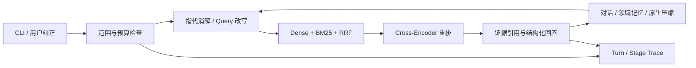

# AsterCite

面向科研论文多轮问答中的指代缺失、检索证据不足和无依据作答问题，基于 Pi SDK 搭建并优化轻量 Agent Harness，构建集 Query 改写、混合检索、引用生成和会话记忆于一体的分阶段可追溯问答 Agent。

## 看效果

需要 Node **24.11.1+**、Python **3.12** 和 Git。在项目根目录执行：

```powershell
npm ci --ignore-scripts
npm run demo
npm run reproduce
npm run check
npm test
npm run test:reproduce
```

demo 回放一组保存的真实四轮对话，显示原回答、来源段落；不会调用模型。reproduce 从逐题 top5、Gold 跨度、保存的答案及显式语义判定重新计分，输出 .local/reproduction/results.md 和 results.json。完整表见 [实验结果](docs/results.md)，分母与来源见 [复现说明](reproduce/README.md)。

| 检索配置 | Span Recall@5 |
|---|---:|
| Dense | 54.08% |
| Dense + BM25 + RRF | 68.58% |
| + Cross-Encoder 重排 | **77.73%** |

RRF 较 Dense 提升 **14.50 个百分点**，重排进一步提升 **9.15 个百分点**。

## 安装本地检索环境

完整检索环境当前验证范围是 **Windows x64 + Python 3.12 + CUDA 12.8 版 Torch**。使用 [uv](https://docs.astral.sh/uv/getting-started/installation/) **0.10.12**：

```powershell
uv sync --frozen --extra retrieval
python scripts/restore_corpus.py --download
python scripts/download_models.py
.venv\Scripts\python.exe -m retriever.p2 build --full --corpus-dir data/full-v1/corpus --models-dir .cache/models --artifacts-dir artifacts/full-v1 --device cuda
```

## 配置自己的生成模型

```powershell
Copy-Item configs/model.example.json configs/model.local.json
```

编辑 model.local.json，填写自己的 base_url、model_id、容量、推理开关及服务兼容参数。通过终端环境变量设置 **PIPAPER_API_KEY**：

```powershell
$credential = Get-Credential -UserName api -Message "密码栏输入你的模型 API key"
$env:PIPAPER_API_KEY = $credential.GetNetworkCredential().Password
npm run doctor
npm run paper -- --session research-demo
```

## 使用 CLI

```text
/corpus Sentence-BERT
/scope 1908.10084
这篇论文如何得到句向量？请引用原文依据。
它和交叉编码器有什么区别？
以后用中文回答，并且只比较推理过程。
/memory
/trace
/budget
/compact
保持刚才的范围，概括我们已确认的结论。
/quit
```

用 npm run paper -- --session research-demo 重新打开同名会话。也支持一次性提问：

```powershell
npm run paper -- --session research-demo --ask "沿用上次论文范围，补充证据来源。"
```

## 结构与能力



| 目录 | 内容 |
|---|---|
| agent/ | Pi 会话编排、边界检查、Trace、记忆与普通 CLI |
| retriever/ | 只加载公开 corpus 的本地检索 worker |
| configs/ | 使用者配置模板 |
| data/ | 语料、权重和来源的固定 manifest；下载文件忽略 |
| reproduce/ | 按指标分开的题集、输出派生记录、语义判定与评分器 |
| demo/ | 保存的真实对话及展示脚本 |
| tests/ | SDK 契约、配置/预算/恢复边界与结果复算 |
| docs/ | 安装、实现说明、结果、验收与版本设计 |

新版本的通用配置与普通 CLI 已做离线协议、预算和恢复验证；没有据此宣布完成一轮新的在线295题正式评测。如何重新运行固定检索或有限 A/C 基准见 [复现说明](reproduce/README.md)，新运行会产生独立身份，原结果不覆盖。

版本 **1.0.0**；原创代码 [MIT](LICENSE)，数据、论文及权重来源见 [第三方许可](THIRD_PARTY.md)，发布记录见 [CHANGELOG](CHANGELOG.md)。SDK开发参考的 pi-agent 技能及其论文来源已登记在第三方说明中。
