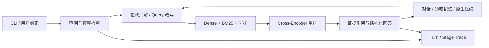

# AsterCite

科研论文多轮证据问答 Agent。用固定本地论文库检索、重排和生成带出处的回答，保留真实对话、用户纠正、阶段 Trace 与可恢复的会话记忆。基于 **Pi SDK 1.0.4** 的单 Agent；Python 检索 worker 与模型会话隔离。

## 先看效果：无需模型、密钥或 GPU

需要 Node **24.11.1+**、Python **3.12** 和 Git。在项目根目录执行：

```powershell
npm ci --ignore-scripts
npm run demo
npm run reproduce
npm run check
npm test
npm run test:reproduce
```

demo 回放一组保存的真实四轮对话，显示原回答、来源段落与结果哈希；不会调用模型。reproduce 从逐题 top5、Gold 跨度、保存的答案及显式语义判定重新计分，输出 .local/reproduction/results.md 和 results.json。完整表见 [实验结果](docs/results.md)，分母与来源见 [复现说明](reproduce/README.md)。

| 检索配置 / 同一原47题 | Span Recall@5 |
|---|---:|
| Dense | 54.08% |
| Dense + BM25 + RRF | 68.58% |
| + Cross-Encoder 重排 | **77.73%** |

RRF 较 Dense 提升 **14.50 个百分点**，重排进一步提升 **9.15 个百分点**。这是旧48篇/2450 chunk索引的证据跨度召回率。其他模块分别使用100题、55题、70题及30组对话等视图；不能把这个数字当成295题的答案准确率。当前98题结果保存在本地实验留档，默认公开表不展示。

## 安装本地检索环境

完整检索环境当前验证范围是 **Windows x64 + Python 3.12 + CUDA 12.8 版 Torch**。使用 [uv](https://docs.astral.sh/uv/getting-started/installation/) **0.10.12**：

```powershell
uv sync --frozen --extra retrieval
python scripts/restore_corpus.py --download
python scripts/download_models.py
.venv\Scripts\python.exe -m retriever.p2 build --full --corpus-dir data/full-v1/corpus --models-dir .cache/models --artifacts-dir artifacts/full-v1 --device cuda
```

下载只由上述命令明确触发：固定 QASPER v0.3 原始档和两份固定 revision 的检索权重（权重文件约4.6 GB）。原始下载、权重、依赖及索引不上传到 Git。恢复过程核对原始 SHA-256；worker 请求本身不上网下载。

构建命令输出索引目录。历史 CUDA 索引为 pipaper-full-index-v1-e7699c38391f1315。先核对目录及 manifest，再填写使用者配置。索引配方见 [环境说明](docs/environment.md)。

CPU 可用同一命令改为 --device cpu，配置也改为 cpu，并使用实际输出的新目录；CPU 索引身份与 CUDA 不同，不能声称复刻历史77.73%。Linux完整检索环境尚未验收，当前 uv.lock 明确限定 Windows；零密钥演示与离线复核不依赖 Torch。

## 配置自己的生成模型

```powershell
Copy-Item configs/model.example.json configs/model.local.json
```

编辑 model.local.json，填写自己的 base_url、model_id、容量、推理开关及服务兼容参数。模板的地址和模型名留空，无法直接发起请求。服务需支持 OpenAI Chat Completions、SSE 与工具调用；跨厂商的真实服务接入未逐家验收。

通过终端环境变量设置 **PIPAPER_API_KEY**。可用交互输入避免把密钥写入命令历史：

```powershell
$credential = Get-Credential -UserName api -Message "密码栏输入你的模型 API key"
$env:PIPAPER_API_KEY = $credential.GetNetworkCredential().Password
npm run doctor
npm run paper -- --session research-demo
```

CLI 不自动读取 .env，不加载个人 Pi 配置。model.local.json、.local/ 会话及凭据均忽略跟踪；仓库没有共享 key。使用完可执行 Remove-Item Env:PIPAPER_API_KEY 清除当前终端变量。费用和账户余额由你选择的服务决定，本项目不填充费用为0。

非推理模型使用 reasoning=false / thinking_level=off。推理模型须显式声明 supportsReasoningEffort=true，再按服务支持设置 low 等级；阶段辅助请求与最终生成采用同一等级。供应商的兼容选项说明见 [配置指南](docs/configuration.md)。

## 使用 CLI

```text
/corpus Sentence-BERT
/scope 1908.10084
这篇论文如何得到句向量？请引用原文依据。
它和交叉编码器有什么区别？
以后用中文回答，并且只比较推理过程。
/memory
/trace
/budget
/compact
保持刚才的范围，概括我们已确认的结论。
/quit
```

用 npm run paper -- --session research-demo 重新打开同名会话。也支持一次性提问：

```powershell
npm run paper -- --session research-demo --ask "沿用上次论文范围，补充证据来源。"
```

默认会话最多20轮、每轮最多12次模型请求尝试、2次 search 与4次 retrieve。失败、格式修正和原生压缩都计数；失败轮不退款，无自动重试。/compact 登记下一轮内的手动原生压缩，退出后仍保留该登记。配置或源码/索引变更会拒绝恢复旧绑定的快照，应新建会话。

## 结构与能力



检索保留论文、章节、段落及 Unicode 原文跨度；回答只可引用当前实际可见的 chunk。引用存在性/范围/原文精确性由宿主校验，语义支持由独立评测判定。记忆保留用户约束的来源和最新纠正，不把模型判断自动标成已确认事实。

产品默认关闭 Reflect。该模块在历史 A/C 对照中增加请求且降低整体完成率，消融结果仍可在复现表核查。日常 CLI 不依赖历史实验排程或耗尽的实验授权。

| 目录 | 内容 |
|---|---|
| agent/ | Pi 会话编排、边界检查、Trace、记忆与普通 CLI |
| retriever/ | 只加载公开 corpus 的本地检索 worker |
| configs/ | 使用者配置模板 |
| data/ | 语料、权重和来源的固定 manifest；下载文件忽略 |
| reproduce/ | 按指标分开的题集、输出派生记录、语义判定与评分器 |
| demo/ | 保存的真实对话及展示脚本 |
| tests/ | SDK 契约、配置/预算/恢复边界与结果复算 |
| docs/ | 安装、实现说明、结果、验收与版本设计 |

## 结果边界与下一步

历史295题采用固定的实验模型及 /low 配置，产品公开模板由使用者自己填模型。原始五分类、宿主接受的分类与 Query 改写是不同指标；主集任务正确率也不同于 Pipeline 完成率。保存的 Gold、答案和改写语义判定来自开发者 AI，尚无独立人工盲评；test177 不是外部 Holdout。服务端模型权重版本和实际账单未知。

新版本的通用配置与普通 CLI 已做离线协议、预算和恢复验证；没有据此宣布完成一轮新的在线295题正式评测。如何重新运行固定检索或有限 A/C 基准见 [复现说明](reproduce/README.md)，新运行会产生独立身份，原结果不覆盖。

版本 **1.0.0**；原创代码 [MIT](LICENSE)，数据、论文及权重来源见 [第三方许可](THIRD_PARTY.md)，发布记录见 [CHANGELOG](CHANGELOG.md)。SDK开发参考的 pi-agent 技能及其论文来源已登记在第三方说明中。
